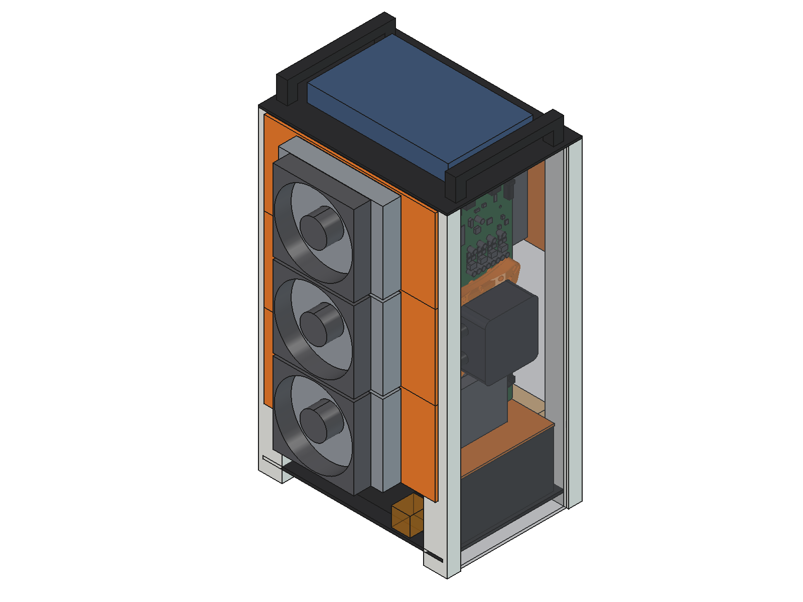

# BC-250 3-node cluster: FreeCAD fit and airflow model

A FreeCAD 1.1 assembly of three ASRock/AMD BC-250 boards in a case built from the Tecmojo rack's
aluminium frames, with a separate PSU box behind it. Each board has a Teucer AF-120 AIO on the APU
and the cut stock heatsink on everything else.


## Layout

Overall footprint: **278 W × 480 D mm**. That is the case plus the PSU box behind it, the cable
channel and its fan on the left, and the switch on the right. The case is 532 mm tall, including
the 30 mm risers and the handles.

- **Case: 206 W × 383 D mm.** The rack's two aluminium side frames (upright + upright + clear
  window) are turned 90° and become the **front and back**, so you look through the windows at
  the nodes. The three node columns sit one behind the other.
  - Two printed **top fascias** replace the original logo plates along each side.
  - A printed top grille and floor replace the steel top and tray, which are too short.
  - The original **handles** move to the front and back of the new top.
  - The column pitch is tightened to 123 mm (0.5 mm around each 120 mm fan), the minimum for
    120 mm fans and radiators.
- **PSU box: 191 W × 95.5 D × 183 H mm, behind the case** (1 mm gap). It is as shallow as it can
  be: the PSU stands on its side with its 86 mm dimension front to back.
  - The PSU fan breathes through a grille in the rear wall. Leave ~20 mm behind it.
  - The AC socket is reached through the right wall.
  - The fan hubs sit on top of the PSU.
  - The lid takes your **90 × 140 mm desk power supply**. Its height is assumed at 40 mm.
- **Cable route.** Every board's PCIe edge faces left. The modular cables leave the PSU into a
  35 mm lane on the box's left side. From there they run forward through a **printed channel
  on the outside of the case's left wall** (17 mm free width, 120 mm tall) and into each column
  through its slot. Nothing shows.
- **4th Arctic.** It is mounted on the channel beside node 2 and blows fresh air into the channel.
  That air leaves through the three cable slots, right beside each node's front VRM heatsink.
- **Switch.** It stands vertically on the outside of the case's right wall with its ports facing
  front. The PSU box lid now holds the desk power supply, and the case top is the radiator
  exhaust.




## Thermal design

The stock BC-250 fins run along the board's length. So the boards stand vertically, I/O end up,
and each node gets its own **bottom-to-top air column**, isolated by printed dividers:

| Layer in each column (bottom to top) | Part | Job |
|---|---|---|
| Intake | Arctic P12, pushing up | Fresh air from under the case (risers, floor grille) |
| Board, front (faces the window) | Cut stock VRM heatsinks and the Teucer cold head between them | VRMs by fins, APU by water |
| Board, back | Stock backplate with the cut-out centre section on it | Memory: GDDR6 → pads → backplate → fins |
| Board, back | BB7515 blower under the memory fins, firing up | Extra pressure for the memory, which has no sensor |
| Top | Radiator with its Teucer fan pulling, exhausting through the top grille | APU heat leaves without heating the boards |

- **Clearances.** 16–17 mm of air on each side of every board slab, between dividers and windows.
- **Radiator inlet.** Each radiator sees only its own node's air: roughly 40–60 W of VRM and
  memory heat, so about 3–4 °C above room temperature at ~25 CFM.
- **Fans.** All 7 120 mm fans and 3 blowers are placed: 3 intakes, 3 radiator fans, 1 cable-channel
  fan and 3 memory blowers.

### Research on an unlocked BC-250

Sources: [BC-250 cooling docs](https://elektricm.github.io/amd-bc250-docs/hardware/cooling/) and
[overclocking docs](https://elektricm.github.io/amd-bc250-docs/bios/overclocking/).

- **APU:** sustained 40 CU at 2 GHz averages 136 W package power, 223 W peak. The GPU throttles
  above ~85 °C. VRMs stayed at 57 °C.
- **Memory:** GDDR6 is all on the underside and has no sensor. The limit is about 80 °C;
  overheating shows up as artifacts or crashes after 30–60 minutes.
- **Wall power:** 220–250 W per board in games, over 320 W at full GPU load (Furmark).

### Thermal risks to watch

1. **The 120 mm radiator is the likely limit** at the 223 W sustained peak. Gaming loads should be
   fine. If the APU passes ~85 °C, cap the GPU clock (the docs suggest 1500 MHz).
2. **The Arctic P12 Silent is weak through fins** (24.1 CFM, 0.5 mmH2O). The P12 Max is a drop-in
   swap if memory or VRM temperatures run high.
3. **PSU headroom:** 3 × 320 W at full GPU load is about the A1000PL's 1000 W limit.

### Power wiring (MSI PRO A1000PL PCIE5)

Each board has three 12 V inputs, all on the same 12 V plane:
- **J1000**, the PCIe 8-pin: 3 × 12 V.
- **J2000 and J2001**, the Molex Micro-Fit 2×4 headers next to it: 3 × 12 V each.

At a full overclock (~320 W, about 27 A), J1000 alone would carry ~9 A per pin. That is the Mini-Fit
limit, and three times the 150 W PCIe rating. Feeding the Micro-Fits as well spreads the current
over 9 pins (about 3 A each).

**The PSU has exactly enough outputs:**
- 5 shared CPU/PCIe 8-pin sockets, which take the 3 PCIe 6+2 cables and the 2 EPS 4+4 cables
  (all 18 AWG).
- 1 × 12V-2x6 socket with its 600 W cable (16 AWG).
- One 12 V rail, 83.3 A.

| Node | J1000 (PCIe 8-pin) | J2000 + J2001 (Micro-Fit) |
|---|---|---|
| 1 | Stock PCIe 6+2 cable | Stock EPS 4+4 cable → EPS-to-2×Micro-Fit adapter |
| 2 | Stock PCIe 6+2 cable | Stock EPS 4+4 cable → EPS-to-2×Micro-Fit adapter |
| 3 | Stock PCIe 6+2 cable | MODDIY 12V-2x6 (PSU socket) to dual PCIe 8-pin direct cable ($24.99, replaces the stock 12V-2x6 cable) **or** the stock 12V-2x6 cable plus a MODDIY 12V-2x6-to-2×PCIe adapter ($19.99). Cheapest finish (shipping to Australia): one PCIe plug → COMeap "PCIe 8-pin female to CPU 8-pin male" adapter (Amazon AU B08M5F7K5J, 18 AWG) → a third MODDIY EPS-to-2×Micro-Fit adapter, the same part as nodes 1–2. That's about US$15 plus about AU$15, against US$78.82 for two eBay PCIe-to-Micro-Fit cables with US$35.65 shipping. MODDIY won't make a one-off adapter that plugs onto a 12V-2x6 cable end: the 16-pin female housing needs a moulded part (support chat, 2026-10-06). |

**DIY option for node 3 (cheapest, fewest connections).** Cut the stock 12V-2x6 cable about
30–40 cm from its PSU end; you lose that cable for any future GPU.
- Its 6 × 12 V and 6 × GND wires (16 AWG) map one to one onto two Micro-Fit plugs: 3 × 12 V +
  3 × GND each.
- Splice each wire to an 18 AWG lead (solder + heat-shrink, staggered). The generic Micro-Fit
  terminals take 18–22 AWG, not 16 AWG.
- Use Micro-Fit 3.0 2×4 plug housings (Molex 43025-0800 style) with socket terminals, e.g.
  AliExpress 1005007856738983, 2×4P variant.
- Cut back the 4 thin sense wires and insulate each one separately.
- Crimping needs an open-barrel crimper for 3.0 mm terminals (e.g. IWISS SN-28B / Engineer PA-09).

**Before building, find each pin's role on the unpowered board with a multimeter:**
- A cavity is 12 V if it beeps to J1000's 12 V pins.
- It is GND if it beeps to J1000's GND pins.
- A pin that beeps to neither is LED or PGD, and must stay empty.

This settles the disagreement between the docs. Before first power-on: pull-test every crimp,
check 12 V to GND is not shorted, and feel the plugs after a 30-minute load.

**Ready-made EPS-to-Micro-Fit adapters:**
- MODDIY "Standard 8 Pin EPS12V to 2 x MicroFit" (16 AWG, 25 cm). Do **not** buy the "Supermicro"
  version: it plugs into a Supermicro PSU, not into a cable.
- mosfet.party's EPS-to-dual-Micro-Fit adapter. Its maker says to always use it together with J1000.

**Safety:**
- Use only MSI's own modular cables on the PSU side. Modular pinouts differ between brands.
- EPS and PCIe 8-pin plugs look alike but swap 12 V and ground. Never force one into the other's
  socket.
- **J2001's PGD pin turns the board off when shorted to ground.** In each Micro-Fit plug, the cavity
  over PGD (and over LED1/LED2 on J2000) must be empty. The community docs disagree on where PGD
  sits, so check the plug against the board before powering on.
- A MODDIY buyer reports cutting the Micro-Fit latches off for the plugs to fit.
- Power every input of a board from this one PSU. Never mix in the desk supply.

**Power on:**
- The boards start as soon as 12 V appears.
- The ATX 24-pin cable only needs PS_ON shorted to ground. A 24-pin jumper with a switch on the
  stock cable lets the PSU's switch start all three nodes.

**Option checked: "ATX 24-pin to 2× 6+2 PCIe with switch" adapter (AliExpress 4000175207092).**
Judged from the product photos:
- **It fits.** The PSU's 24-pin cable ends in a standard ATX plug, and the PCIe plugs are standard
  6+2.
- **It works as the power-on switch.** Its rocker switches PS_ON.
- **It's a weak 12 V source.** Only two 12 V wires (18 AWG) enter it, one per PCIe plug, with a
  loop bridging the plug's other 12 V pins. Each plug is about one wire (~7–8 A, ~90 W).
- **Feeding node 3's Micro-Fits from it:**
  - It would carry only ~20–25 % of node 3's current (estimate).
  - Node 3's J1000 would stay at ~7 A per pin, against ~3–4 A with the 12V-2x6 route.
  - If node 3's PCIe cable ever came loose, that single wire would take the whole board's current.
    The PSU's 92 A over-current limit would not trip.
- **Use it as the power-on switch and leave its PCIe plugs unplugged.** Keep the 12V-2x6 route
  for node 3.
- Before first use, check with a multimeter: 12 V on the three pins in one row of each PCIe plug.
- The cable model doesn't yet reserve space for that coiled 24-pin cable or for the adapters' split
  points. The plug keep-out at each node already covers all three plugs.

**Budget:**

| Load | Per node | Three nodes | PSU load |
|---|---|---|---|
| Sustained 40 CU compute at 2 GHz | 220–230 W | ~690 W | ~70 % |
| Furmark, overclocked | 320 W | ~960 W | 96 % |

The first is comfortable. The second leaves no margin: cap the GPU clock if all three will run flat
out together.

Sources: [BC-250 power docs](https://elektricm.github.io/amd-bc250-docs/hardware/power/),
[pinouts](https://elektricm.github.io/amd-bc250-docs/hardware/pinouts/),
[mothenjoyer69 hardware notes](https://github.com/mothenjoyer69/bc250-documentation/blob/main/hardware.md),
[Cybenetics A1000PL report](https://www.cybenetics.com/evaluations/psus/3058/),
[MSI spec](https://www.msi.com/Power-Supply/PRO-A1000PL-PCIE5/Specification),
[mosfet.party adapter](https://mosfet.party/products/eps-8pin-to-dual-microfit),
[MODDIY adapter](https://www.moddiy.com/products/6837/Standard-8-Pin-EPS12V-to-2-x-MicroFit-8-Pin-Cable-for-ASRock-BC250.html).

### Other wiring

- Put each node's pump, radiator fan and blower on **that node's own fan headers**. The hubs then
  run the 4 Arctics, which are 3-pin and fixed-speed. The hubs take power from a PSU SATA cable.
- Each node's power button sits under its radiator. Set the **AUTO_PWRON** jumper so the nodes boot
  when the PSU switches on.

## Cooler compatibility

- **Radiator:** 155 × 120 mm, as you supplied. The thickness is still assumed at 27 mm.
- **Tubes:** your tubes are 300 mm. The model's longest run is 239 mm along the centre line.
- **Mounting:** the Teucer block's hardware covers AM4/AM5, LGA2011, LGA17xx, 115x and 1366. The
  NexGen "AM4 - Generic" bracket is drilled for the AM4/AM5 and LGA1700/1851 patterns, so the
  Teucer's AM4 or LGA17xx hardware should line up. Confirm when the coolers arrive.
- **Update 2026-10-09:**
  - The modelled V1 bracket is obsolete. Its V2 is Thermalright-specific and clamps with a plate
    on the back of the board, where the memory heatsink goes.
  - The plan is now a Teucer-specific mount that screws into the cut centre piece's posts. See
    `BUILD.md`.

## Still unknown

1. **Radiator thickness** (`RADIATOR_THICKNESS` in `cad/build_cluster.py`) and **desk power supply
   height** (`DESK_PSU_SIZE`, assumed 40 mm).
2. **Upright cross-section once the frames are turned.** Assumed 20 × 35 mm, which puts the window
   7 mm in from the outside. Each column's radiator clears the uprights by only 2.5 mm, so check
   this.
3. **NexGen bracket test-fit.** The fit report shows its underside resting on 0.4 mm SMD parts,
   probably a board-model inaccuracy.
4. **Memory heatsink placement.** It sits on the stock backplate as you asked. Set
   `MEMORY_HEATSINK_ON_STOCK_BACKPLATE = False` for MandicReally's direct-on-memory arrangement.
5. Printed parts are concept geometry for fit and airflow, not print-ready designs.

## Files

| Path | Purpose |
|---|---|
| `BUILD.md` | Build order, the heatsink-cut procedure and the measurements needed before printing |
| `bc250_cluster.FCStd` | The assembly. Open it in FreeCAD 1.1. |
| `cad/build_cluster.py` | Builds the assembly. All dimensions and assumptions are constants at the top. |
| `cad/check_fit.py` | Clash, keep-out, clearance, size and tube-length report -> `cad/fit_report.md` |
| `cad/render_views.py` | PNG views -> `cad/renders/` |
| `reference/` | Downloaded Printables models. See `reference/SOURCES.md` for authors, licences and spec sources. |

## Rebuild

```powershell
$fc = "C:\Program Files\FreeCAD 1.1\bin"
$env:BC250_EXIT_AFTER_BUILD = 1; & "$fc\freecad.exe" cad\build_cluster.py    # GUI build keeps colours
& "$fc\freecadcmd.exe" cad\check_fit.py                                      # ~2.5 min
$env:BC250_EXIT_AFTER_RENDER = 1; & "$fc\freecad.exe" cad\render_views.py
```

## Licences

The board model (MandicReally, CC BY-NC-SA) and the NexGen3D mount (CC BY-NC-ND) are embedded in
`bc250_cluster.FCStd`. Keep it for personal use, or share it only under those terms.
