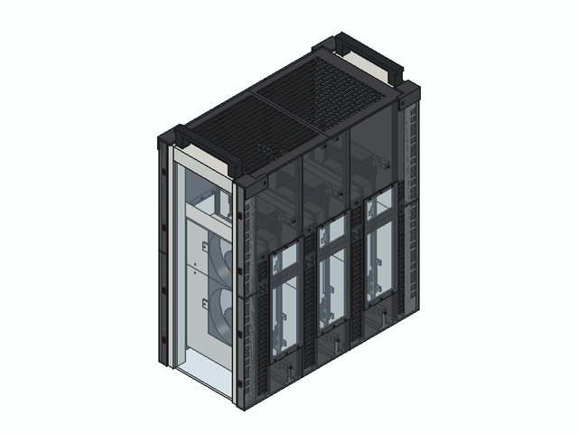
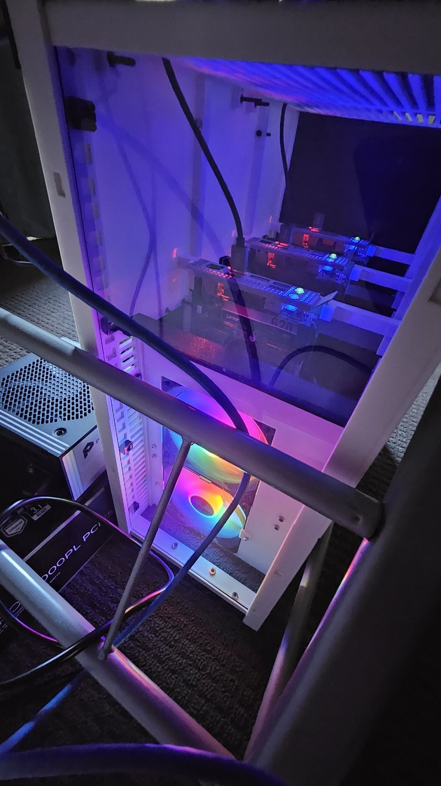

# bc250-chassis

A case for three AMD BC-250 boards, designed in FreeCAD from Python scripts, 3D-printed, built and
thermally tested. It holds the cluster that runs
[bc250-gitops](https://github.com/nitpreet22/bc250-gitops).

The GIF shows Version 1, the air-cooled case that is built and running. Version 2 adds an AIO
water cooler to each board and is modelled in the same repo.

*The built case, running the cluster.*

## Design

- **Reused frames.** The aluminium side frames of a 10" rack are turned 90° to become the case's
  front and back. Printed PLA parts make up the rest: side walls, roof grille and the three node
  columns.
- **One air column per board (Version 1).** The boards stand vertically, each in its own column.
  Two 120 mm fans blow straight into the stock heatsink, the hot air rises out through the roof
  grille, and a BB7515 blower cools the memory on the backplate.
- **Version 2 (AIO, modelled).** Adds an intake fan under each column, an AIO cold plate on the
  APU and a radiator exhausting through the top, with the PSU in a box behind the case.
- **Power.** One 1000 W PSU feeds each board through its PCIe and Micro-Fit inputs, spreading about
  27 A per board over 9 pins. [`docs/DESIGN.md`](docs/DESIGN.md) has the pinouts, safety checks,
  thermal research and cooler fit.
- **Footprint (Version 1):** 212 × 427 mm, 503 mm tall.

## Measured (Version 1 case, stock heatsinks)

All three boards ran a worst-case 100 % CPU (AVX2) and GPU (Vulkan compute) load together for
30 minutes. They stayed below 80 °C on the BIOS's quiet fan curve:

| Node | CPU cap | GPU cap | Tctl, last 5 min | CPU GFLOPS | GPU GFLOPS |
|---|---|---|---|---|---|
| 1 | 3000 MHz | 1500 MHz | 71 °C | 208 | 3875 |
| 2 | 2300 MHz | 1500 MHz | 78 °C | 159 | 3867 |
| 3 | 2800 MHz | 1500 MHz | 75 °C | 194 | 3871 |

The method, every run and how the caps are applied through the SMU are in `bench/RESULTS-V1.md`.

## Layout

| Path | What's in it |
|---|---|
| `cad/build_v1.py`, `cad/v1_model.py`, `cad/build_cluster.py` | Build the Version 1 (air-cooled) and Version 2 (AIO) assemblies in FreeCAD |
| `cad/check_fit.py`, `cad/fit_report*.md` | Clearance checks between every part |
| `cad/print/` | Printable parts (STL export, print settings, test coupons) |
| `cad/renders/` | Rendered views |
| `bench/` | CPU and GPU burn tools, the thermal test harness, results |
| `node-setup/` | Fedora setup, CPU limits through the SMU, remote desktop |
| `BUILD.md` | Step-by-step build guide |

## Rebuilding the model

1. Download the reference models listed in `reference/SOURCES.md` into `reference/`. They are not
   redistributed here because of their licences.
2. Run `"C:\Program Files\FreeCAD 1.1\bin\freecad.exe" cad\build_v1.py`, which writes
   `bc250_v1.FCStd` (Version 1). `cad\build_cluster.py` writes `bc250_cluster.FCStd` (Version 2).

The BC-250 board, backplate and heatsink geometry in the model and renders come from
[MandicReally's BC250 CAD model](https://www.printables.com/model/1828755-asrock-bc250-complete-ish-cad-model)
(CC BY-NC-SA 4.0). The AIO bracket is
[NexGen3D's BC-250 mount](https://www.printables.com/model/1554003-nexgen3d-aio-mount-for-the-bc-250)
(CC BY-NC-ND 4.0).

## License

MIT for this repository's own files. See [LICENSE](LICENSE). The third-party models credited above
keep their own licences.
