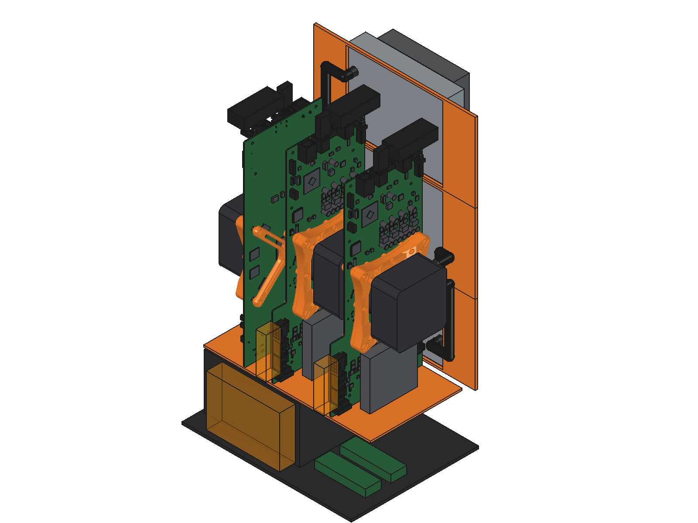

# BC-250 3-node cluster: FreeCAD fit model

A FreeCAD 1.1 assembly showing three ASRock/AMD BC-250 boards, each with a Teucer AF-120 AIO,
and the rest of `parts.txt`, fitted to the Tecmojo 9U 10" mini rack (200 mm deep).



## Result

All three boards, their cold heads and mounts, the PSU, the blowers, the fan hubs, the dongles
and one Arctic intake fan fit inside the 9U rack. The fit checker finds no clashes between these
parts or with the rack (see the one model-level note below).

Three 120 mm radiators do not fit inside as well. The rack is only 210 mm wide at the uprights
(~266 mm between the side panels) and 200 mm deep, and three board slabs already take 228 mm.
As agreed, the **radiators hang outside the rear rails** on printed plates, each with an Arctic
P12 as exhaust. That adds 58.5 mm of depth behind the rack (261.5 mm overall). The **switch
sits on the top panel**, between the handles.

| Zone | What sits there |
|---|---|
| Floor (Z 22-108) | MSI A1000PL lying flat (fan down), 2 PWM fan hubs beside it |
| Card shelf (Z 108.5) | Printed plate the boards stand on |
| Boards (Z 112-424) | 3 BC-250s vertical, I/O end up; 18-21 mm between neighbouring boards' hardware, 4 mm from pump to side panel |
| Top zone (Z 424-466) | USB plugs + 2.5G dongle bodies (17 mm below the roof) |
| Front | Printed 3U panel with Arctic P12 intake; PCIe cable space for nodes 2 and 3 |
| Rear opening | 6 tubes routed in lanes between the uprights (2 mm clearance at the outer lanes) |
| Outside rear | 3 radiators + 3 Arctic P12 exhaust fans |
| On top | TL-SG105-M2 switch |

**Board orientation.** You can't mirror a PCB. Node 1's pump faces the left wall, so that
board is rotated 180° and **its power connectors face the rear**. Nodes 2 and 3 take power at
the front.

**Parts list allocation.** 4x Arctic P12 = 3 radiator exhausts + 1 front intake. The three
Teucer RGB fans are spares. 3x BB7515 blowers sit over each board's front VRM.

## Open checks before printing or buying

1. **Measure the rack.** Clear width between the side panels (assumed 266), upright depth
   (20) and floor height (22). Every board position depends on the first of these.
2. **Measure a Teucer radiator** (assumed 155 x 120 x 27) and its **tube length**. The
   longest modelled tube is 242 mm along its centre line, and the bends here are schematic.
3. **Test-fit the NexGen "AM4 - Generic" mount with the Teucer pump.** NexGen lists Teucer
   fitment as still being tested. In the models, the bracket's underside rests on 0.4 mm SMD
   parts, and one corner overlaps a 3.5 mm part by ~1.8 mm (fit report). That is probably a
   board-model inaccuracy.
4. Not designed yet: the card cage that holds the boards upright (only a shelf is modelled),
   the radiator plates, the front fan panel, cable routing, and airflow and thermal behaviour.

## Files

| Path | Purpose |
|---|---|
| `bc250_cluster.FCStd` | The assembly. Open it in FreeCAD 1.1. |
| `cad/build_cluster.py` | Builds the assembly. All dimensions and assumptions are constants at the top. |
| `cad/check_fit.py` | Clash, keep-out, envelope, clearance and tube-length report -> `cad/fit_report.md` |
| `cad/render_views.py` | PNG views -> `cad/renders/` |
| `reference/` | Downloaded Printables models. See `reference/SOURCES.md` for authors, licences and spec sources. |

Orange translucent boxes (`KO_*`) are keep-outs for cables that aren't modelled (PCIe/Micro-Fit
plugs, PSU modular cables, AC cord).

## Rebuild

```powershell
$fc = "C:\Program Files\FreeCAD 1.1\bin"
$env:BC250_EXIT_AFTER_BUILD = 1; & "$fc\freecad.exe" cad\build_cluster.py    # GUI build keeps colours
& "$fc\freecadcmd.exe" cad\check_fit.py                                      # ~2.5 min
$env:BC250_EXIT_AFTER_RENDER = 1; & "$fc\freecad.exe" cad\render_views.py
```

After measuring the rack or radiator, change the constants in `build_cluster.py` and run all three
steps again. The checker will report anything that no longer fits.

## Licences

The board model (MandicReally, CC BY-NC-SA) and the NexGen3D mount (CC BY-NC-ND) are embedded in
`bc250_cluster.FCStd`. Keep it for personal use, or share it only under those terms.
