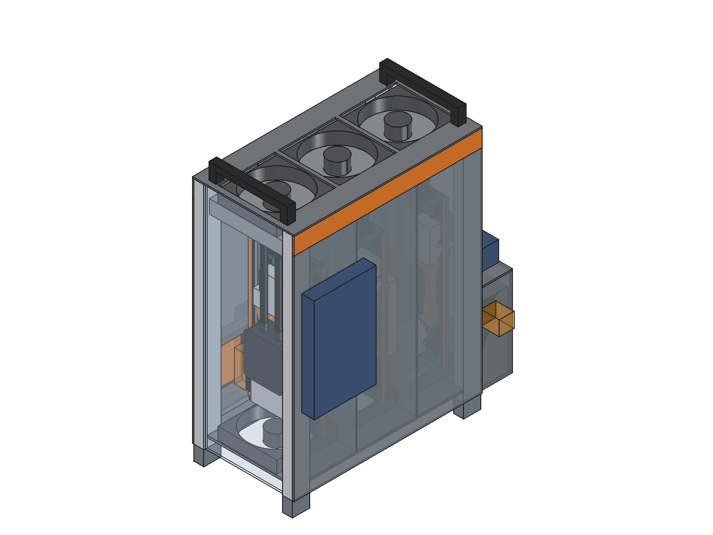
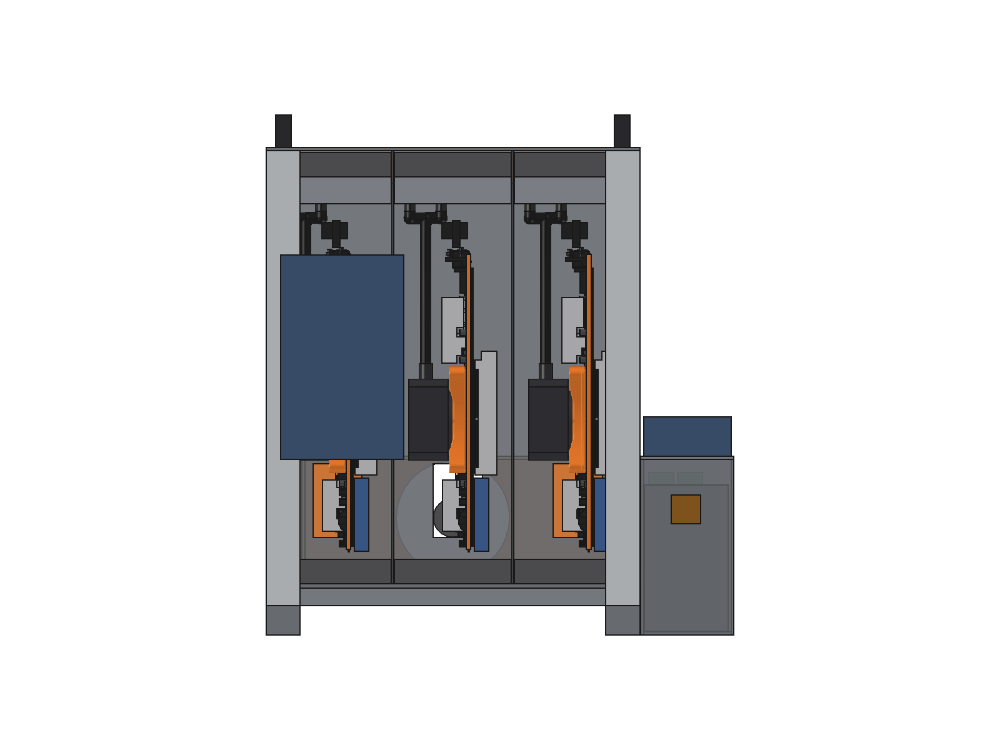

# BC-250 3-node cluster: FreeCAD fit and airflow model

A FreeCAD 1.1 assembly of three ASRock/AMD BC-250 boards in a case built from the Tecmojo rack's
aluminium frames, with a separate PSU box behind it. Each board has a Teucer AF-120 AIO on the APU
and the cut stock heatsink on everything else.



## Layout

Overall footprint: **278 W × 480 D mm**. That is the case plus the PSU box behind it, the cable
channel and its fan on the left, and the switch on the right. The case is 532 mm tall, including
the 30 mm risers and the handles.

- **Case: 206 W × 383 D mm.** The rack's two aluminium side frames (upright + upright + clear
  window) are turned 90° and become the **front and back**, so you look through the windows at
  the nodes. The three node columns sit one behind the other.
  - Two printed **top fascias** replace the original logo plates along each side.
  - A printed top grille and floor replace the steel top and tray, which are too short.
  - The original **handles** move to the front and back of the new top.
  - The column pitch is tightened to 123 mm (0.5 mm around each 120 mm fan), the minimum for
    120 mm fans and radiators.
- **PSU box: 191 W × 95.5 D × 183 H mm, behind the case** (1 mm gap). It is as shallow as it can
  be: the PSU stands on its side with its 86 mm dimension front to back.
  - The PSU fan breathes through a grille in the rear wall. Leave ~20 mm behind it.
  - The AC socket is reached through the right wall.
  - The fan hubs sit on top of the PSU.
  - The lid takes your **90 × 140 mm desk power supply**. Its height is assumed at 40 mm.
- **Cable route.** Every board's PCIe edge faces left. The modular cables leave the PSU into a
  35 mm lane on the box's left side. From there they run forward through a **printed channel
  on the outside of the case's left wall** (17 mm free width, 120 mm tall) and into each column
  through its slot. Nothing shows.
- **4th Arctic.** It is mounted on the channel beside node 2 and blows fresh air into the channel.
  That air leaves through the three cable slots, right beside each node's front VRM heatsink.
- **Switch.** It stands vertically on the outside of the case's right wall with its ports facing
  front. The PSU box lid now holds the desk power supply, and the case top is the radiator
  exhaust.




## Thermal design

The stock BC-250 fins run along the board's length. So the boards stand vertically, I/O end up,
and each node gets its own **bottom-to-top air column**, isolated by printed dividers:

| Layer in each column (bottom to top) | Part | Job |
|---|---|---|
| Intake | Arctic P12, pushing up | Fresh air from under the case (risers, floor grille) |
| Board, front (faces the window) | Cut stock VRM heatsinks and the Teucer cold head between them | VRMs by fins, APU by water |
| Board, back | Stock backplate with the cut-out centre section on it | Memory: GDDR6 → pads → backplate → fins |
| Board, back | BB7515 blower under the memory fins, firing up | Extra pressure for the memory, which has no sensor |
| Top | Radiator with its Teucer fan pulling, exhausting through the top grille | APU heat leaves without heating the boards |

- **Clearances.** 16–17 mm of air on each side of every board slab, between dividers and windows.
- **Radiator inlet.** Each radiator sees only its own node's air: roughly 40–60 W of VRM and
  memory heat, so about 3–4 °C above room temperature at ~25 CFM.
- **Fans.** All 7 120 mm fans and 3 blowers are placed: 3 intakes, 3 radiator fans, 1 cable-channel
  fan and 3 memory blowers.

### Research on an unlocked BC-250

Sources: [BC-250 cooling docs](https://elektricm.github.io/amd-bc250-docs/hardware/cooling/) and
[overclocking docs](https://elektricm.github.io/amd-bc250-docs/bios/overclocking/).

- **APU:** sustained 40 CU at 2 GHz averages 136 W package power, 223 W peak. The GPU throttles
  above ~85 °C. VRMs stayed at 57 °C.
- **Memory:** GDDR6 is all on the underside and has no sensor. The limit is about 80 °C;
  overheating shows up as artifacts or crashes after 30–60 minutes.
- **Wall power:** 220–250 W per board in games, over 320 W at full GPU load (Furmark).

### Thermal risks to watch

1. **The 120 mm radiator is the likely limit** at the 223 W sustained peak. Gaming loads should be
   fine. If the APU passes ~85 °C, cap the GPU clock (the docs suggest 1500 MHz).
2. **The Arctic P12 Silent is weak through fins** (24.1 CFM, 0.5 mmH2O). The P12 Max is a drop-in
   swap if memory or VRM temperatures run high.
3. **PSU headroom:** 3 × 320 W at full GPU load is about the A1000PL's 1000 W limit.

### Wiring

- Put each node's pump, radiator fan and blower on **that node's own fan headers**. The hubs then
  run the 4 Arctics, which are 3-pin and fixed-speed.
- The PSU has exactly **3 PCIe 6+2 cables**, one per node.
- Each node's power button sits under its radiator. Set the **AUTO_PWRON** jumper so the nodes boot
  when the PSU switches on.

## Cooler compatibility

- **Radiator:** 155 × 120 mm, as you supplied. The thickness is still assumed at 27 mm.
- **Tubes:** your tubes are 300 mm. The model's longest run is 239 mm along the centre line.
- **Mounting:** the Teucer block's hardware covers AM4/AM5, LGA2011, LGA17xx, 115x and 1366. The
  NexGen "AM4 - Generic" bracket is drilled for the AM4/AM5 and LGA1700/1851 patterns, so the
  Teucer's AM4 or LGA17xx hardware should line up. Confirm when the coolers arrive.

## Still unknown

1. **Radiator thickness** (`RADIATOR_THICKNESS` in `cad/build_cluster.py`) and **desk power supply
   height** (`DESK_PSU_SIZE`, assumed 40 mm).
2. **Upright cross-section once the frames are turned.** Assumed 20 × 35 mm, which puts the window
   7 mm in from the outside. Each column's radiator clears the uprights by only 2.5 mm, so check
   this.
3. **NexGen bracket test-fit.** The fit report shows its underside resting on 0.4 mm SMD parts,
   probably a board-model inaccuracy.
4. **Memory heatsink placement.** It sits on the stock backplate as you asked. Set
   `MEMORY_HEATSINK_ON_STOCK_BACKPLATE = False` for MandicReally's direct-on-memory arrangement.
5. Printed parts are concept geometry for fit and airflow, not print-ready designs.

## Files

| Path | Purpose |
|---|---|
| `bc250_cluster.FCStd` | The assembly. Open it in FreeCAD 1.1. |
| `cad/build_cluster.py` | Builds the assembly. All dimensions and assumptions are constants at the top. |
| `cad/check_fit.py` | Clash, keep-out, clearance, size and tube-length report -> `cad/fit_report.md` |
| `cad/render_views.py` | PNG views -> `cad/renders/` |
| `reference/` | Downloaded Printables models. See `reference/SOURCES.md` for authors, licences and spec sources. |

## Rebuild

```powershell
$fc = "C:\Program Files\FreeCAD 1.1\bin"
$env:BC250_EXIT_AFTER_BUILD = 1; & "$fc\freecad.exe" cad\build_cluster.py    # GUI build keeps colours
& "$fc\freecadcmd.exe" cad\check_fit.py                                      # ~2.5 min
$env:BC250_EXIT_AFTER_RENDER = 1; & "$fc\freecad.exe" cad\render_views.py
```

## Licences

The board model (MandicReally, CC BY-NC-SA) and the NexGen3D mount (CC BY-NC-ND) are embedded in
`bc250_cluster.FCStd`. Keep it for personal use, or share it only under those terms.
